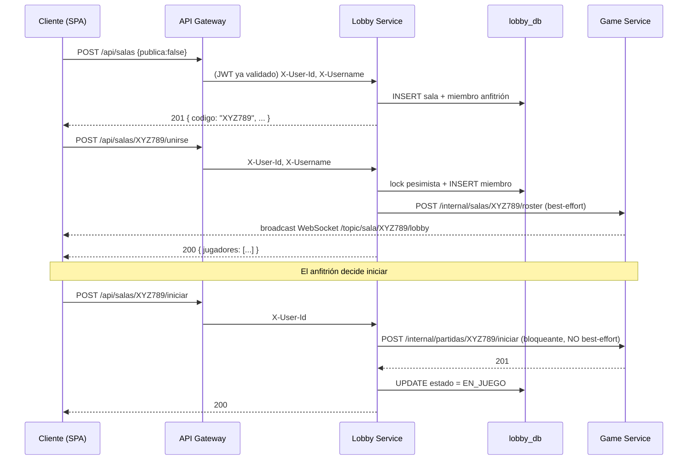
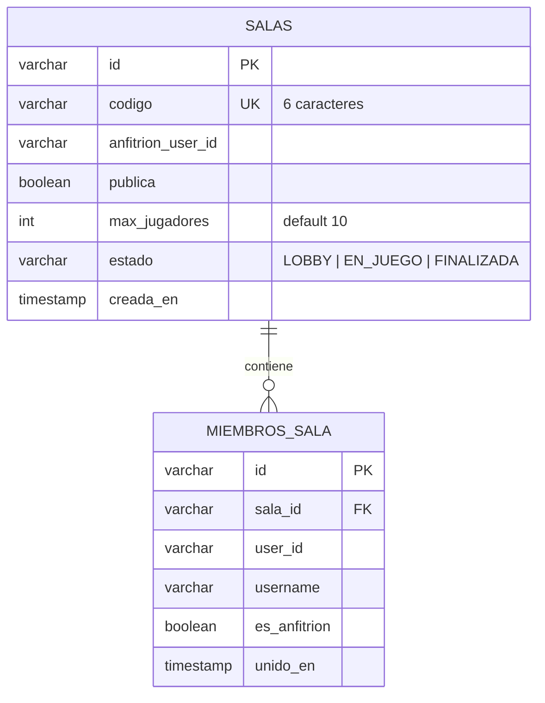
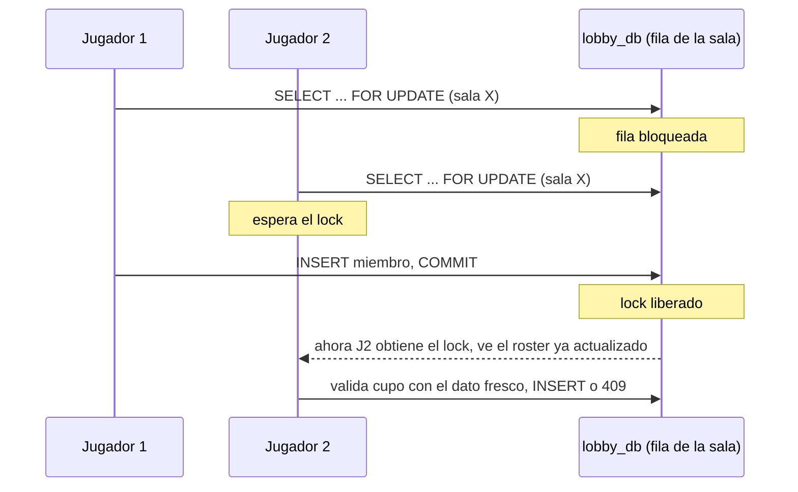

# Lobby Service

> Creación de salas, matchmaking público y transferencia de control al Game Service —
> microservicio de **UNO Power-Ups Arena**.

[](https://github.com/UNO-POWER/LobbyService/actions/workflows/ci.yml)
[]()
[]()
[]()
[]()

---

## Tabla de contenidos

1. [Descripción](#1-descripción)
2. [Arquitectura](#2-arquitectura)
3. [Tecnologías](#3-tecnologías)
4. [Requisitos](#4-requisitos)
5. [Instalación](#5-instalación)
6. [Configuración](#6-configuración)
7. [Ejecución](#7-ejecución)
8. [Estructura del proyecto](#8-estructura-del-proyecto)
9. [Flujo interno](#9-flujo-interno)
10. [API](#10-api)
11. [Base de datos](#11-base-de-datos)
12. [Seguridad](#12-seguridad)
13. [Concurrencia](#13-concurrencia)
14. [Logs](#14-logs)
15. [Observabilidad](#15-observabilidad)
16. [Testing](#16-testing)
17. [Despliegue](#17-despliegue)
18. [Solución de problemas](#18-solución-de-problemas)
19. [Roadmap](#19-roadmap)
20. [Contribución](#20-contribución)
21. [Licencia](#21-licencia)
22. [Autor](#22-autor)

---

## 1. Descripción

**Lobby Service** administra el ciclo de vida de una sala de UNO **antes** de que empiece la
partida: creación con código único, unirse con ese código, listado de salas públicas
(matchmaking) y la transferencia de control al [Game Service](../GameService) cuando el anfitrión
decide iniciar.

No tiene UI propia: lo consume el [API Gateway](../APIGATEWAY) (`/api/salas/**`) y llama
internamente al Game Service para avisarle de cambios de roster o para arrancar la partida.

### Historias de usuario que implementa

| HU | Descripción | Endpoint |
|---|---|---|
| **HU-01** | Crear sala de juego privada con código único de 6 caracteres | `POST /api/salas` |
| **HU-02** | Unirse a una sala existente mediante código | `POST /api/salas/{codigo}/unirse` |
| **HU-09** | Matchmaking público: listar y unirse a salas abiertas | `GET /api/salas/publicas` |
| (soporte a HU-03) | El anfitrión inicia la partida → transfiere control al Game Service | `POST /api/salas/{codigo}/iniciar` |

### Responsabilidad exacta

- Ser la única fuente de verdad de **qué salas existen**, quién es el anfitrión y quién está
  adentro, antes de que la partida arranque.
- Generar códigos de sala **legibles y sin ambigüedad** (sin `O`/`0`/`I`/`1`).
- Garantizar que **nunca** entren más de `maxJugadores` (10) a una sala, incluso con dos jugadores
  uniéndose en el mismo instante (ver [§13 Concurrencia](#13-concurrencia)).
- Delegar, una vez iniciada la partida, **toda** la lógica de juego al Game Service — Lobby Service
  no sabe jugar UNO, solo sabe organizar la sala de espera.

### Cómo interactúa con los demás servicios



---

## 2. Arquitectura

```
                    ┌──────────────┐
   Internet ──────▶ │ API Gateway  │  (valida JWT, enruta /api/salas/**)
                    └──────┬───────┘
                           │ REST + X-User-Id + X-Username + X-Trace-Id
                           ▼
                    ┌──────────────┐  HTTP interno + X-Internal-Key   ┌──────────────┐
                    │ Lobby Service│ ────────────────────────────────▶│ Game Service │
                    │   :8082      │  roster (best-effort) / iniciar  │   :8083      │
                    └──────┬───────┘  (bloqueante)                    └──────────────┘
                           │ JDBC
                           ▼
                    ┌──────────────┐
                    │  lobby_db     │
                    └──────────────┘
```

**Capas internas:**

```
Controller (REST)  →  Service (reglas + lock pesimista)  →  Repository (Spring Data JPA)  →  PostgreSQL
                              │
                              └── GameServiceClient (HTTP saliente hacia Game Service)
```

Diferencia clave entre las dos llamadas salientes a Game Service:

| Llamada | Modo | Si Game Service no responde |
|---|---|---|
| `notificarRosterActualizado` (al unirse) | **best-effort**, no bloquea | Se ignora el error; el cliente puede refrescar con `GET /api/salas/{codigo}` |
| `iniciarPartida` (al iniciar) | **bloqueante** | La sala **no** se marca `EN_JUEGO`; se responde `502` (ver EC-04) |

---

## 3. Tecnologías

| Tecnología | Versión | Uso |
|---|---|---|
| Java | 21 | Lenguaje |
| Spring Boot | 3.2.5 | Framework |
| Spring Web (MVC) | incluido en Boot 3.2.5 | Controllers REST + `RestClient` saliente |
| Spring Data JPA | incluido en Boot 3.2.5 | Persistencia + lock pesimista (`@Lock`) |
| Spring Boot Validation | incluido en Boot 3.2.5 | Validación de DTOs |
| Spring Boot Actuator + Micrometer | incluido en Boot 3.2.5 | Health, métricas Prometheus |
| PostgreSQL Driver | incluido en Boot 3.2.5 | JDBC |
| Logstash Logback Encoder | 7.4 | Logs JSON estructurados |
| JUnit 5 + Mockito | incluido en Boot 3.2.5 | Testing |
| JaCoCo | 0.8.12 | Cobertura de tests |
| Maven | 3.9+ | Build |
| Docker | multi-stage | Empaquetado |

---

## 4. Requisitos

- **Java 21** (JDK).
- **Maven 3.9+**.
- **PostgreSQL 16** con el schema `lobby_db` creado.
- **Game Service corriendo** (o al menos alcanzable) para probar `/unirse` e `/iniciar`
  end-to-end — sin él, `crear` y `obtener` sala funcionan igual, pero `iniciar` fallará con `502`.
- **Docker** (opcional).

---

## 5. Instalación

```bash
# 1. Clonar
git clone https://github.com/UNO-POWER/LobbyService.git
cd LobbyService

# 2. Verificar Java 21
java -version

# 3. Postgres local (si no existe ya de otro servicio del sistema)
docker run -d --name uno-postgres-dev \
  -e POSTGRES_USER=uno -e POSTGRES_PASSWORD=uno -e POSTGRES_DB=uno \
  -p 5432:5432 postgres:16-alpine
docker exec -i uno-postgres-dev psql -U uno -d uno -c "CREATE SCHEMA IF NOT EXISTS lobby_db;"

# 4. Compilar
mvn -q -DskipTests package

# 5. Tests
mvn test
```

---

## 6. Configuración

| Variable | Obligatoria en prod | Valor por defecto (dev) | Descripción |
|---|---|---|---|
| `SPRING_DATASOURCE_URL` | ✅ | `jdbc:postgresql://localhost:5432/uno?currentSchema=lobby_db` | JDBC con schema propio |
| `SPRING_DATASOURCE_USERNAME` | ✅ | `uno` | Usuario BD |
| `SPRING_DATASOURCE_PASSWORD` | ✅ | `uno` | Contraseña BD |
| `GAME_SERVICE_URL` | ✅ | `http://localhost:8083` | Base URL del Game Service (roster / iniciar) |
| `INTERNAL_API_KEY` | ✅ | clave de ejemplo | Enviada como `X-Internal-Key` al llamar a Game Service |
| `SERVER_PORT` | ❌ | `8082` | Puerto HTTP |

No requiere `JWT_SECRET`: Lobby Service **no valida JWT** — confía por completo en que el API
Gateway ya lo hizo y le pasó `X-User-Id`/`X-Username` (ver [§12](#12-seguridad)).

---

## 7. Ejecución

### Desarrollo

```bash
SPRING_DATASOURCE_URL="jdbc:postgresql://localhost:5432/uno?currentSchema=lobby_db" \
SPRING_DATASOURCE_USERNAME=uno SPRING_DATASOURCE_PASSWORD=uno \
GAME_SERVICE_URL="http://localhost:8083" \
INTERNAL_API_KEY="una-clave-larga" \
mvn spring-boot:run
```

```bash
curl http://localhost:8082/actuator/health
```

### Producción (JAR)

```bash
mvn -q -DskipTests package
java -jar target/lobbyservice-0.1.0.jar
```

### Docker

```bash
docker build -t uno-lobby-service .
docker run -p 8082:8082 \
  -e SPRING_DATASOURCE_URL="jdbc:postgresql://host.docker.internal:5432/uno?currentSchema=lobby_db" \
  -e SPRING_DATASOURCE_USERNAME=uno -e SPRING_DATASOURCE_PASSWORD=uno \
  -e GAME_SERVICE_URL="http://host.docker.internal:8083" \
  -e INTERNAL_API_KEY="..." \
  uno-lobby-service
```

### Docker Compose (stack completo)

```bash
docker compose up -d --build lobby-service
```

Ver la [guía de infraestructura](../deploy/README.md) para el stack completo.

---

## 8. Estructura del proyecto

```
LobbyService/
├── src/main/java/com/unopower/lobbyservice/
│   ├── LobbyServiceApplication.java
│   ├── controller/
│   │   └── SalaController.java        # /api/salas/** (crear, unirse, publicas, obtener, iniciar)
│   ├── service/
│   │   ├── SalaService.java            # reglas de negocio + lock pesimista + retry de código
│   │   ├── CodigoSalaGenerator.java     # genera codigos de 6 chars sin O/0/I/1, verifica unicidad
│   │   ├── GameServiceClient.java       # RestClient saliente hacia Game Service
│   │   ├── SalaNoEncontradaException.java     # 404
│   │   ├── SalaLlenaException.java            # 409
│   │   ├── SalaYaIniciadaException.java       # 400
│   │   ├── NoEresAnfitrionException.java      # 403
│   │   ├── JugadoresInsuficientesException.java # 400
│   │   └── GameServiceNoDisponibleException.java # 502
│   ├── model/
│   │   ├── Sala.java            # entidad JPA (tabla `salas`)
│   │   ├── MiembroSala.java     # entidad JPA (tabla `miembros_sala`)
│   │   └── EstadoSala.java      # enum LOBBY / EN_JUEGO / FINALIZADA
│   ├── repository/
│   │   └── SalaRepository.java  # incluye variante con @Lock(PESSIMISTIC_WRITE)
│   ├── dto/                     # CrearSalaRequest, MiembroResponse, SalaResponse,
│   │                             # SalaPublicaResponse, ListaSalasPublicasResponse
│   └── web/
│       └── GlobalExceptionHandler.java
├── src/main/resources/
│   ├── application.yml
│   └── logback-spring.xml
├── src/test/java/…/service/
│   ├── SalaServiceTest.java          # 14 tests
│   └── CodigoSalaGeneratorTest.java  # 2 tests
├── Dockerfile
└── pom.xml
```

---

## 9. Flujo interno

### Crear sala (`POST /api/salas`)

1. `SalaController` lee `X-User-Id`/`X-Username` (propagados por el Gateway; si faltan, `400`
   — señal de que alguien llamó saltándose el Gateway).
2. `CodigoSalaGenerator.generarUnico()` produce 6 caracteres del alfabeto
   `ABCDEFGHJKLMNPQRSTUVWXYZ23456789` (sin `O`/`0`/`I`/`1`) y verifica contra la BD que no exista.
3. `SalaService.crear()` ejecuta dentro de una transacción explícita (`TransactionTemplate`): si
   la restricción `UNIQUE(codigo)` de la BD detecta una colisión de todos modos (ventana de carrera
   entre el chequeo y el `INSERT`), se reintenta con un código nuevo hasta 3 veces.
4. Se persiste la `Sala` y su primer `MiembroSala` (el anfitrión).
5. Responde `201` con el roster completo.

### Unirse (`POST /api/salas/{codigo}/unirse`)

1. `findByCodigoForUpdate` toma un **lock pesimista** (`SELECT ... FOR UPDATE`) sobre la fila de la
   sala — bloquea a cualquier otra transacción que intente unirse o iniciar la misma sala hasta que
   esta termine.
2. Valida: sala existe (`404`), está en `LOBBY` (`400` si ya inició), tiene cupo (`409` si llena).
3. Si el jugador ya está en la sala, la operación es **idempotente** (no lo duplica).
4. Notifica a Game Service (`notificarRosterActualizado`) — **best-effort**: si falla, se loguea
   como warning y la respuesta al cliente sigue siendo `200`.

### Iniciar (`POST /api/salas/{codigo}/iniciar`)

1. Mismo lock pesimista que unirse.
2. Solo el `anfitrionUserId` puede iniciar (`403` si no).
3. Requiere ≥2 jugadores (`400` si no).
4. Llama a Game Service `POST /internal/partidas/{codigo}/iniciar` — **esta sí es bloqueante y
   propaga el error** (`502`) si Game Service no responde, precisamente para no dejar la sala en
   `EN_JUEGO` sin que exista una partida real corriendo del otro lado.
5. Solo si la llamada tuvo éxito, se actualiza `estado = EN_JUEGO`.

---

## 10. API

Todos accesibles vía API Gateway bajo `/api/salas/**`.

### `POST /api/salas`

- **Autenticación:** requerida (JWT vía Gateway → `X-User-Id`, `X-Username`)
- **Body** (opcional):
```json
{ "publica": true }
```
(`publica` por defecto `false` si se omite el body o el campo)

**Respuesta `201 Created`:**
```json
{
  "codigo": "QTUQY2",
  "anfitrionUserId": "guest-d8ffd64f-1530-448f-8ef6-b0fe327a2b15",
  "publica": false,
  "maxJugadores": 10,
  "estado": "LOBBY",
  "jugadores": [
    { "userId": "guest-d8ffd64f-...", "username": "Ana", "esAnfitrion": true }
  ]
}
```

---

### `POST /api/salas/{codigo}/unirse`

- **Autenticación:** requerida

**Respuesta `200 OK`:** mismo formato que crear, con el roster actualizado.

**Errores:**

| Código | Causa |
|---|---|
| `404` | código no existe |
| `400` | la sala ya inició (`estado != LOBBY`) |
| `409` | sala llena (10/10) |

---

### `GET /api/salas/{codigo}`

- **Autenticación:** requerida

Devuelve el estado actual de la sala (mismo formato). Útil como *fallback* si el WebSocket se
desincroniza.

**Errores:** `404` si no existe.

---

### `GET /api/salas/publicas` (HU-09)

- **Autenticación:** requerida
- **Query params:** `pagina` (default `0`), `tamano` (default `20`, máximo `50`)

**Ejemplo:** `GET /api/salas/publicas?pagina=0&tamano=20`

**Respuesta `200 OK`:**
```json
{
  "salas": [
    { "codigo": "6CRBWM", "anfitrionUsername": "Carla", "jugadores": 1, "maxJugadores": 10 }
  ],
  "pagina": 0,
  "totalPaginas": 1,
  "totalSalas": 1
}
```

Solo incluye salas `publica=true`, `estado=LOBBY` y con cupo disponible (filtradas en memoria tras
la consulta paginada). No expone `anfitrionUserId` ni la lista completa de jugadores — solo lo
necesario para el listado de matchmaking.

---

### `POST /api/salas/{codigo}/iniciar`

- **Autenticación:** requerida (debe ser el anfitrión)

**Respuesta `200 OK`:** `{ ..., "estado": "EN_JUEGO" }`

**Errores:**

| Código | Causa |
|---|---|
| `403` | quien llama no es el anfitrión |
| `400` | ya inició, o hay menos de 2 jugadores |
| `404` | código no existe |
| `502` | Game Service no respondió al iniciar la partida (EC-04: la sala no queda a medias) |

---

## 11. Base de datos

Schema propio: **`lobby_db`**.



| Tabla | Restricciones clave |
|---|---|
| `salas` | `UNIQUE(codigo)` — base del retry de generación de códigos |
| `miembros_sala` | `FK(sala_id) → salas.id`, `ON DELETE CASCADE` (vía `orphanRemoval=true` en JPA) |

`sala.miembros` se carga con `fetch = FetchType.EAGER` (deliberado: cada operación de sala
necesita el roster completo de inmediato, y el volumen — máximo 10 filas por sala — hace
irrelevante el costo del join).

---

## 12. Seguridad

- **No valida JWT directamente** — modelo de "Gateway autoritativo": confía en los headers
  `X-User-Id`/`X-Username` que el Gateway solo agrega **después** de validar la firma del token.
  Si Lobby Service se expusiera directamente sin pasar por el Gateway, cualquiera podría
  suplantar identidades — por eso en despliegue de producción **no publica puerto al host**
  (ver [`docker-compose.prod.yml`](../deploy/docker-compose.prod.yml)).
- **`X-Internal-Key`** en las llamadas salientes a Game Service — mismo secreto compartido que
  usa User Service.
- **Autorización explícita**: solo el `anfitrionUserId` guardado en la fila puede iniciar la
  partida (verificado en servidor, no confía en el cliente).
- **Lock pesimista** como control de concurrencia, no solo de seguridad, pero también previene
  condiciones de carrera que un cliente malicioso podría explotar enviando requests paralelas.

---

## 13. Concurrencia

Dos jugadores presionando "Unirse" en el mismo milisegundo, o un anfitrión iniciando mientras otro
jugador se une, se resuelven así:



Esto garantiza que el chequeo "¿hay cupo?" y el `INSERT` del nuevo miembro sean **atómicos** desde
la perspectiva de la fila de esa sala — sin el lock, dos requests podrían leer "9/10" al mismo
tiempo y ambas insertar, dejando la sala en 11/10.

La generación de código único usa un mecanismo distinto (optimista, con retry) porque ahí la
colisión es estadísticamente rarísima (1 en ~30⁶) y no vale la pena pagar el costo de un lock.

---

## 14. Logs

JSON estructurado (mismo formato que los demás servicios), campo `service: "lobby-service"`,
`traceId` propagado desde el Gateway.

```json
{
  "@timestamp": "2026-07-08T21:06:57.0Z",
  "message": "jugador unido codigo=6CFS7W userId=guest-... totalJugadores=2",
  "logger_name": "com.unopower.lobbyservice.service.SalaService",
  "level": "INFO",
  "service": "lobby-service"
}
```

---

## 15. Observabilidad

- `GET /actuator/health` (incluye estado de la conexión JDBC).
- `GET /actuator/prometheus` — scrapeado por Prometheus (job `lobby-service`, cada 5s).
- No define métricas de negocio propias; las de negocio (KPI-1 a KPI-4) viven en Game Service.

---

## 16. Testing

```bash
mvn test
mvn test jacoco:report   # target/site/jacoco/index.html
```

**16 tests** (JUnit 5 + Mockito):

| Archivo | Cubre |
|---|---|
| `SalaServiceTest` (14 tests) | crear (con/sin sala pública), retry ante colisión de código, unirse (agrega/idempotente/llena/inexistente/ya-iniciada), iniciar (solo anfitrión, mínimo 2 jugadores, rollback si Game Service falla, éxito delega correctamente), listar públicas (excluye llenas, acota el tamaño de página) |
| `CodigoSalaGeneratorTest` (2 tests) | formato de 6 caracteres sin ambigüedad, reintento si el código ya existe en BD |

---

## 17. Despliegue

- **Docker**: `Dockerfile` multi-stage (Maven → JRE Alpine), igual patrón que los demás servicios.
- **Docker Compose**: servicio `lobby-service` en [`docker-compose.yml`](../docker-compose.yml)
  (dev) y en [`deploy/docker-compose.prod.yml`](../deploy/docker-compose.prod.yml) (producción,
  sin puerto publicado al host, solo alcanzable vía Gateway y desde Game Service).
- **AWS**: contenedor en la misma EC2 que el resto del backend, contra RDS (schema `lobby_db`).
  Ver el [runbook de despliegue](../deploy/DEPLOY.md).

---

## 18. Solución de problemas

| Síntoma | Causa probable | Solución |
|---|---|---|
| `502` al iniciar partida | Game Service caído o `GAME_SERVICE_URL` mal configurada | Verificar `curl $GAME_SERVICE_URL/actuator/health` |
| `403` en `/{codigo}/iniciar` | Quien llama no es el anfitrión de esa sala | Confirmar el `userId` del JWT contra `anfitrionUserId` |
| Dos jugadores ven cupos distintos momentáneamente | Comportamiento esperado bajo carga: uno espera el lock unos milisegundos | No es un bug — verificar con `GET /{codigo}` que el estado final es consistente |
| `400` al unirse a una sala recién creada | La sala ya pasó a `EN_JUEGO` (el anfitrión inició mientras tanto) | Comportamiento esperado; el cliente debe manejar este caso en la UI |
| El código generado nunca se repite pero tarda | Extremadamente improbable con el alfabeto de 33 símbolos; si ocurre, revisar que la BD no esté devolviendo falsos positivos en `existsByCodigo` | Verificar el índice `UNIQUE(codigo)` |

---

## 19. Roadmap

- Expulsar jugadores del lobby (solo el anfitrión, antes de iniciar).
- Salas con contraseña (privadas pero compartibles con un PIN adicional al código).
- Filtros en el matchmaking público (por cantidad de jugadores, por región).
- Cancelar/cerrar una sala manualmente sin necesidad de que todos se desconecten.

---

## 20. Contribución

1. Rama descriptiva: `feature/...` o `fix/...`.
2. Toda mutación de `Sala`/`MiembroSala` que toque cupo o estado debe pasar por
   `findByCodigoForUpdate` (lock pesimista) — no usar `findByCodigo` para escrituras.
3. Tests obligatorios para cambios en `SalaService` (Mockito, sin necesidad de una BD real).
4. `mvn test` antes de abrir PR.
5. Commits en [Conventional Commits](https://www.conventionalcommits.org/).

---

## 21. Licencia

MIT — ver [`LICENSE`](../LICENSE) en el repositorio raíz.

---

## 22. Autor

**DUCU** — Desarrollador Full-Stack (individual), proyecto de la asignatura ARSW.
Organización GitHub: [UNO-POWER](https://github.com/UNO-POWER).

Repositorio raíz del sistema: **[UNO Power-Ups Arena](../README.md)**.
